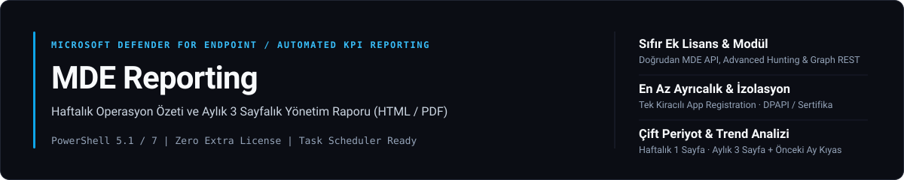

<p align="center">
  <picture>
    <source media="(prefers-color-scheme: dark)" srcset="./assets/banner-dark.svg" />
    <source media="(prefers-color-scheme: light)" srcset="./assets/banner-light.svg" />
    
  </picture>
</p>

<p align="center">
  <a href="https://github.com/canercetinkaya/mde-reporting/actions/workflows/ci.yml"></a>
  
  
  
  <a href="./LICENSE"></a>
</p>

---

**MDE Reporting**, Microsoft Defender for Endpoint (MDE) ortamları için **haftalık operasyon özeti (1 sayfa)** ve **aylık yönetim raporu (3 sayfa, önceki dönem trend kıyaslamalı)** üreten, **Windows Task Scheduler** ile tam otomatik çalışan açık kaynak PowerShell raporlama çözümüdür.

Power BI, Power Automate, Azure Automation veya harici PowerShell modülü gerektirmez; doğrudan Microsoft Defender for Endpoint API, Advanced Hunting ve Microsoft Graph REST uç noktalarını kullanır.

---

## Temel Yetenekler

- **Tek Ekran Kurulum Sihirbazı (`Install-MDEReport.ps1`):** Entra ID üzerinde tek kiracılı uygulama kaydını oluşturur, en az ayrıcalıklı uygulama izinlerini ekler, yönetici onayını verir, gizli anahtarı DPAPI ile şifreler, 9 adımlı erişim testini koşar ve Windows Task Scheduler görevlerini (**S4U** modu) kurar.
- **Çift Raporlama Modu:**
  - **Haftalık Özet (`-Mode Weekly`):** Tek sayfalık operasyonel özet; aktif/pasif cihazlar, sensör sorunları, yüksek şiddetli alert'ler, açık incident'lar, tekrar eden bulgu üreten cihazlar ve eşik tabanlı **Dikkat Gerektiren Başlıklar**.
  - **Aylık Yönetim Raporu (`-Mode Monthly`):** 3 sayfalık A4 baskı dostu rapor; yönetici özeti, endpoint kapsamı ve OS dağılımı, **önceki dönemle karşılaştırmalı** tehdit koruma tablosu, incident şiddet dağılımı, en çok görülen 10 tehdit, Advanced Hunting tehdit avcılığı bulguları ve response aksiyon özetleri.
- **HTML + Headless PDF + E-posta Dağıtımı:** Rapor doğrudan e-posta gövdesinde okunabilir HTML olarak gönderilir; sunucuda Microsoft Edge varsa otomatik A4 PDF üretilip eklenir. Microsoft Graph (`sendMail`) veya kurumsal SMTP desteklenir.
- **Güvenlik ve Dayanıklılık:**
  - Yazma veya cihaz müdahalesi izni (`Isolate`, `Scan`) istemez; SMTP seçildiğinde `Mail.Send` izni bile talep edilmez.
  - Tüm dış/API kaynaklı alanlar HTML-encode (`ConvertTo-HtmlSafe`) edilir ve rapor sıkı çevrimdışı CSP (`default-src 'none'`) içerir.
  - HTTP 429/5xx için üstel geri çekilme, kısmi veri toleransı, ham JSON + `kpi.json` arşivleme ve hata durumunda operasyon uyarısı (`AlertTo`) sunar.
- **Kod Sabit, Yapılandırma Değişken:** Kurum adı, hizmet sağlayıcı/SOC ekip adı (`ProviderName`), alıcılar, logo ve eşikler `customer.json` dosyasındadır; çoklu kurum/müşteri dağıtımlarında tek satır kod değiştirilmez.

---

## Hızlı Kurulum

1. Depoyu indirin ve sunucuda kısa bir klasöre kopyalayın (örneğin `C:\MDEReport`).
2. **`Kurulum-Baslat.cmd`** dosyasına çift tıklayın veya PowerShell'de şu komutları çalıştırın:

```powershell
cd C:\MDEReport
Set-ExecutionPolicy -Scope Process -ExecutionPolicy Bypass -Force
Get-ChildItem *.ps1 | Unblock-File
.\Install-MDEReport.ps1
```

Mevcut bir Entra ID App Registration kaydınız varsa:

```powershell
.\Install-MDEReport.ps1 -UseExistingApp
```

---

## Günlük Kullanım ve Doğrulama

```powershell
# 9 adımlı salt okunur API ve ortam doğrulaması
.\New-MDEReport.ps1 -Test

# Mail göndermeden deneme raporu üretimi
.\New-MDEReport.ps1 -Mode Weekly  -DryRun
.\New-MDEReport.ps1 -Mode Monthly -DryRun

# Belirli bir dönem için CSV arşiviyle aylık rapor üretimi
.\New-MDEReport.ps1 -Mode Monthly -Date 2026-07-15 -ExportCsv -DryRun

# Üretim çalıştırması (HTML + PDF + E-posta)
.\New-MDEReport.ps1 -Mode Monthly -Pdf
```

---

## Gereken İzinler (Application Permissions)

| API | İzin | Kapsam |
| :--- | :--- | :--- |
| WindowsDefenderATP | `Machine.Read.All` | Cihaz envanteri, sensör sağlığı, response aksiyonları |
| WindowsDefenderATP | `Alert.Read.All` | Alert verisi |
| WindowsDefenderATP | `AdvancedQuery.Read.All` | Advanced Hunting KQL sorguları |
| Microsoft Graph | `SecurityIncident.Read.All` | Incident durumu, şiddeti ve sınıflandırması |
| Microsoft Graph | `Mail.Send` *(isteğe bağlı)* | Yalnızca Graph ile mail gönderimi seçildiğinde gerekir; `New-ApplicationAccessPolicy` ile tek posta kutusuna kısıtlanması önerilir |

---

## Dokümantasyon

- [Kurulum, İzin Kısıtlama ve Geri Dönüş Kılavuzu](docs/KURULUM.md)
- [Mimari Tasarım ve 4 Bölümlü KPI Kataloğu](docs/ARCHITECTURE.md)
- [Örnek Yapılandırma Dosyası (`customer.example.json`)](customer.example.json)

---

## Geliştirme ve Doğrulama Testleri

```powershell
# PSScriptAnalyzer statik kod analizi
Invoke-ScriptAnalyzer -Path . -Recurse -Settings .\PSScriptAnalyzerSettings.psd1

# Pester birim, XSS, KPI ve gizli bilgi sızıntı testleri
Invoke-Pester -Path .\tests -Output Detailed
```

---

## Lisans

Bu proje [MIT Lisansı](LICENSE) altında açık kaynak olarak sunulmaktadır.
